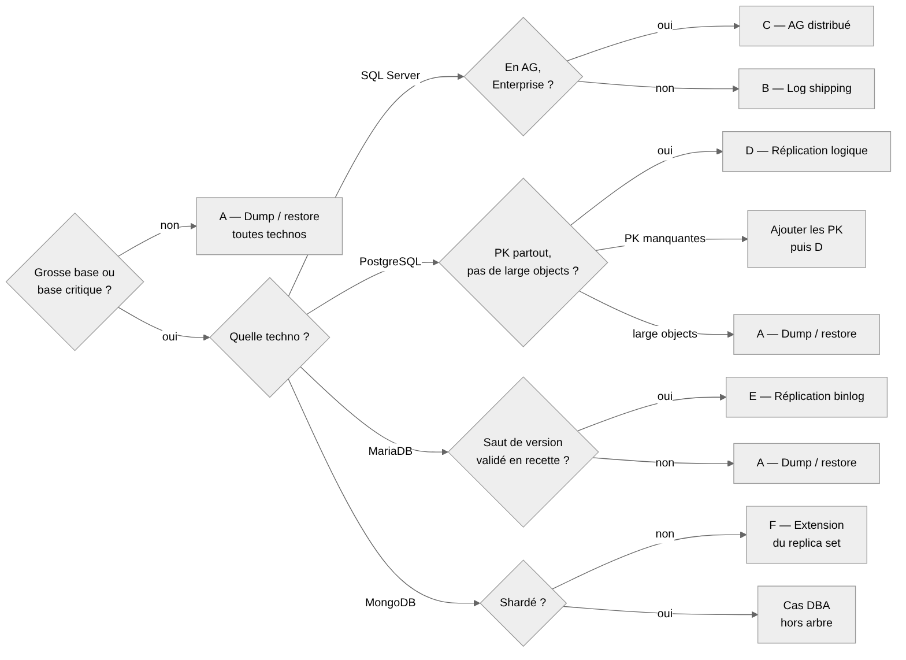

# Migration : choisir sa méthode

## L'essentiel

Par défaut, on fait un dump / restauration. On ne met en place une synchronisation avant la bascule (log shipping, AG distribué, réplication logique, binlog ou extension de replica set) que pour les grosses bases ou les bases critiques. Cela vaut pour les standalone comme pour les clusters.

Contexte : l'OS des serveurs BDD est obsolète (Windows d'un côté, Linux de l'autre). On ne met pas l'OS à jour en place : on monte une nouvelle VM, avec un moteur à jour (versions cibles sur la page [Choisir sa base de données](01-choisir-sa-base.md)).

Sources les plus anciennes du parc : PostgreSQL 10 et SQL Server 2016. Toutes les méthodes s'appliquent à ces versions, avec les points d'attention notés pour chacune.

## Ce que ça implique

- Le moteur change toujours de version : les copies de fichiers (réaffectation de disque, réplication physique PostgreSQL, `mariadb-backup`) sont exclues.
- Seule exception, MongoDB (méthode F) : les nouveaux membres démarrent dans la version source (ou la majeure suivante), puis montent jusqu'à la cible sur la nouvelle VM, une majeure à la fois.
- Retour arrière :
  - **D (PostgreSQL)** : vrai retour arrière, par réplication inverse.
  - **F (MongoDB)** : retour arrière simple tant que les anciens membres sont dans le replica set.
  - **Toutes les autres** : la migration est à sens unique. Le retour arrière consiste à revenir sur l'ancien serveur, figé au moment de la bascule ; les écritures faites entre-temps sur le nouveau sont perdues.
- On ne supprime l'ancien serveur qu'après une période de sécurité.

## Choisir sa méthode

**Grosse base** : la copie complète, mesurée en recette, dépasse la moitié de la fenêtre de coupure. Le reste de la fenêtre sert aux contrôles, aux tests et au rollback éventuel.

**Base critique** : l'appli figure dans la liste des applis critiques. Tant que cette liste n'est pas arrêtée : coupure acceptable inférieure à 1 h, ou appli utilisée 24 h / 24 (proposition à valider).

Filtre rapide avant la mesure (ordres de grandeur à confirmer sur nos disques) :

| Techno | Dump par défaut jusqu'à | Débit indicatif dump + restore |
|---|---|---|
| SQL Server | 200 Go | 200 à 500 Mo/s |
| PostgreSQL | 200 Go | 50 à 150 Mo/s |
| MariaDB | 50 Go, mesurer au-delà | 10 à 30 Mo/s (restauration mono-thread) |
| MongoDB | 50 Go, mesurer au-delà | 20 à 50 Mo/s, plus la reconstruction des index |

Estimation : durée (min) ≈ taille (Go) × 1024 ÷ débit (Mo/s) ÷ 60. Exemple : 200 Go à 100 Mo/s ≈ 34 min. Seule la mesure en recette fait foi.

| Situation | Méthode |
|---|---|
| Petite base non critique, toutes technos, standalone ou cluster | A — Dump / restauration |
| Grosse ou critique, SQL Server standalone, ou en AG sans Enterprise | B — Log shipping |
| Grosse ou critique, SQL Server en AG, Enterprise | C — AG distribué |
| Grosse ou critique, PostgreSQL standalone ou repmgr | D — Réplication logique |
| Grosse ou critique, MariaDB, saut de version validé en recette | E — Réplication binlog (sinon A) |
| Grosse ou critique, MongoDB en replica set ou standalone | F — Extension du replica set |
| MongoDB shardé | Cas étudié par le DBA, hors arbre |

## Les 6 méthodes en bref

Les commandes pas à pas de chaque méthode sont dans l'onglet Runbooks techniques.

### A — Sauvegarde / restauration (toutes technos)

**Quand** : cas par défaut : petites bases et bases non critiques, en standalone comme en cluster.

**Principe** : on arrête les écritures, on sauvegarde, on restaure sur le nouveau serveur, on bascule.

- **SQL Server** : full restaurée la veille `WITH NORECOVERY`, puis seulement les logs et le tail-log le jour J pour raccourcir la coupure.
- **PostgreSQL** : `pg_dumpall --globals-only` puis `pg_dump` / `pg_restore` en parallèle, avec les binaires PG 17.
- **MariaDB** : `mariadb-dump` streamé directement vers la cible, sans fichier local.
- **MongoDB** : `mongodump --archive` streamé vers `mongorestore --archive` sur la cible, avec `--oplog` / `--oplogReplay` pour un replica set (dump cohérent de l'instance entière).

**Attention** : la durée se mesure lors d'une répétition, elle ne s'estime pas.

### B — Log shipping (SQL Server)

**Quand** : grosse base ou base critique, source standalone, ou en AG sans pouvoir utiliser la méthode C.

**Principe** : la base est restaurée sur le nouveau serveur puis alimentée en continu par les sauvegardes de log. Le jour J : tail-log, dernière restauration, mise en ligne.

**Attention** : toute autre sauvegarde de log sur la source (Commvault, plan de maintenance) casse la chaîne. Vers 2022, la base cible reste illisible jusqu'à la bascule.

### C — AG distribué (SQL Server en AG)

**Quand** : grosse base ou base critique, source en AG (2016 ou plus), édition Enterprise (à confirmer).

**Principe** : un nouvel AG sur le nouveau cluster Windows est relié à l'ancien et se synchronise seul. Le jour J, on bascule d'un AG à l'autre.

**Attention** : le listener change de nom, donc bascule par alias DNS. Méthode la plus lourde, réservée aux bases critiques.

### D — Réplication logique (PostgreSQL)

**Quand** : grosse base ou base critique, en standalone ou en cluster repmgr.

**Principe** : le nouveau serveur (ou le primaire du nouveau cluster repmgr) s'abonne aux tables de l'ancien et reste synchronisé. Le jour J : arrêt des écritures, recalage des séquences, bascule.

**Attention** :

- Ni les changements de schéma, ni les séquences, ni les large objects ne sont répliqués : gel des changements de schéma pendant la synchronisation.
- Source en PostgreSQL 10 : les `TRUNCATE` ne sont pas répliqués (ils le sont à partir de PG 11). Aucun `TRUNCATE` pendant la synchronisation : à vérifier avec la squad (batchs, purges).
- Chaque table a besoin d'une clé primaire. Sinon on en ajoute une, ou on passe la table en `REPLICA IDENTITY FULL` (acceptable pour les petites tables seulement).
- Des large objects (`pg_largeobject`) en volume : méthode A, sauf avis contraire du DBA.
- Le slot de réplication retient les WAL sur la source tant que l'abonné n'a pas suivi : surveiller l'espace disque de la source.
- Seule méthode qui permet un vrai retour arrière, par réplication inverse.

### E — Réplication binlog (MariaDB)

**Quand** : grosse base ou base critique.

**Principe** : le nouveau serveur est chargé par un dump logique qui note la position GTID, monté en réplica de l'ancien, puis promu au moment de la bascule.

**Attention** :

- Un saut de plusieurs versions majeures (10.x vers 12.3) est à valider en recette ; sinon méthode A.
- La rétention des binlogs sur la source doit couvrir la durée du dump et du chargement.
- Les tables MyISAM empêchent un dump cohérent sans verrou : à convertir en InnoDB avant, ou à copier pendant la coupure.
- Désactiver les events sur la cible jusqu'à la bascule.

### F — Extension du replica set (MongoDB)

**Quand** : grosse base ou base critique, en replica set. Une source standalone est d'abord convertie en replica set à 1 membre (redémarrage court, à planifier).

**Principe** : les nouvelles VM sont ajoutées comme membres du replica set existant, dans la version source (ou la majeure suivante), et se synchronisent seules (initial sync). Le jour J, on donne la priorité aux nouveaux membres et le primaire bascule en quelques secondes. Les anciens membres sont ensuite retirés, puis la version monte sur les nouvelles VM, une majeure à la fois, jusqu'à la cible.

**Attention** :

- Vérifier que la version source existe pour l'OS de la nouvelle VM. Sinon : monter d'abord la version sur l'ancien serveur, ou méthode A.
- La fenêtre de l'oplog doit dépasser la durée de l'initial sync, sinon la synchronisation échoue.
- Les nouveaux membres sont ajoutés sans vote ni priorité tant qu'ils ne sont pas synchronisés.
- Les chaînes de connexion doivent passer par l'enregistrement SRV (`mongodb+srv://`) : une appli qui ne liste que les anciens hôtes perd la connexion à leur retrait.
- Retour arrière simple tant que les anciens membres sont dans le replica set. Après la montée du `featureCompatibilityVersion`, la migration est à sens unique.

## Avant de choisir : les questions à se poser avec le DBA

**Pour toutes les technos**

- Quelle coupure est acceptable le jour J, en minutes ?
- Combien de temps dure une copie complète de la base ? On le mesure lors d'une répétition.
- Comment les applis se connectent-elles : alias DNS, listener AG, enregistrement SRV, ou nom de serveur en dur ?
- Quels objets hors base faut-il recréer : comptes, droits, jobs planifiés, liens entre serveurs ?

**Selon la techno**

- **SQL Server** : la base est-elle en AG ? Quelle édition et quelle version source ?
- **PostgreSQL** : version source (en PG 10, l'appli fait-elle des `TRUNCATE`) ? Tables sans clé primaire, large objects ?
- **MariaDB** : version source ? Tables en MyISAM ? Rétention des binlogs ?
- **MongoDB** : version source, et existe-t-elle sur l'OS cible ? Replica set, standalone ou shardé ? Fenêtre de l'oplog ?

## Jour J : même déroulé pour toutes les méthodes

1. Le CAB valide la méthode, la fenêtre et le critère de retour arrière avant toute copie de données.
2. Comptes, droits et jobs déjà recréés sur le nouveau serveur.
3. Arrêt des applis (ou source en lecture seule).
4. Synchronisation finale selon la méthode.
5. Contrôles DBA : nombre de lignes (de documents pour MongoDB), intégrité, index, statistiques recalculées.
6. Bascule de l'alias DNS ou de l'enregistrement SRV (ou des chaînes de connexion si pas d'alias).
7. Tests applicatifs par la squad, puis go / no-go avant l'heure limite.
8. Sauvegarde Commvault et supervision Zabbix actives sur le nouveau serveur, retirées de l'ancien.
9. Ancien serveur arrêté mais conservé, puis supprimé après la période de sécurité (MODOP042).

| Qui | Fait quoi |
|---|---|
| Squad | Demande, fenêtre de coupure, arrêt et tests des applis, go / no-go |
| DBA | Choix de la méthode, installation du moteur, migration, contrôles techniques |
| ASR | Bascule de l'alias DNS |

## Règles de migration

- **Répétition obligatoire en recette** pour toute base de prod : elle mesure la durée réelle de copie et tranche entre dump et synchronisation.
- **Alias DNS systématique** : toute base qui n'en a pas en reçoit un pendant sa migration (un enregistrement SRV pour MongoDB). La prochaine migration se fera sans toucher aux applis.
- **dbatools pour SQL Server** : `Copy-DbaLogin`, `Copy-DbaAgentJob` et `Copy-DbaDatabase` pour les logins avec leur SID, les jobs et la restauration.
- **Niveau de compatibilité SQL Server** conservé à la bascule (130 pour une source 2016), Query Store activé, montée à 160 après quelques semaines sans régression.
- **Suivi par base** dans l'onglet Suivi des migrations : techno, méthode, durée mesurée, date de bascule, statut. Il sert aussi au planning par vagues.

## À reporter dans MODOP031

- La migration et la vérification des bases sont réalisées par le DBA, pas par le responsable technique de la plateforme. L'échange passe par iTop, pas par email.
- Le CAB passe avant la copie des données, avec la méthode, la fenêtre et le critère de rollback.
- Ajout d'une étape de bascule explicite : arrêt des écritures, synchronisation finale, contrôles.
- Ajout du plan de rollback et d'une période de conservation de l'ancien serveur avant MODOP042.
- Ajout de la mise sous Commvault et Zabbix du nouveau serveur, et de leur retrait sur l'ancien.
- RACI : DBA réalisateur de la migration des bases, ASR réalisateur de la bascule d'alias.
- MongoDB entre dans le périmètre de la procédure.

## À trancher

- Version MariaDB cible (12.3 LTS proposée) et sa disponibilité sur le miroir interne.
- Version MongoDB cible (8.0 proposée), édition (Community ou Enterprise) et disponibilité sur le miroir interne.
- Présence de MongoDB shardé dans le parc.
- Liste des applis critiques, et critère provisoire en attendant.
- Éditions SQL Server du parc : Enterprise requise pour la méthode C.
- Débits indicatifs MongoDB à mesurer sur nos disques.
- Durée de conservation de l'ancien serveur avant suppression.
